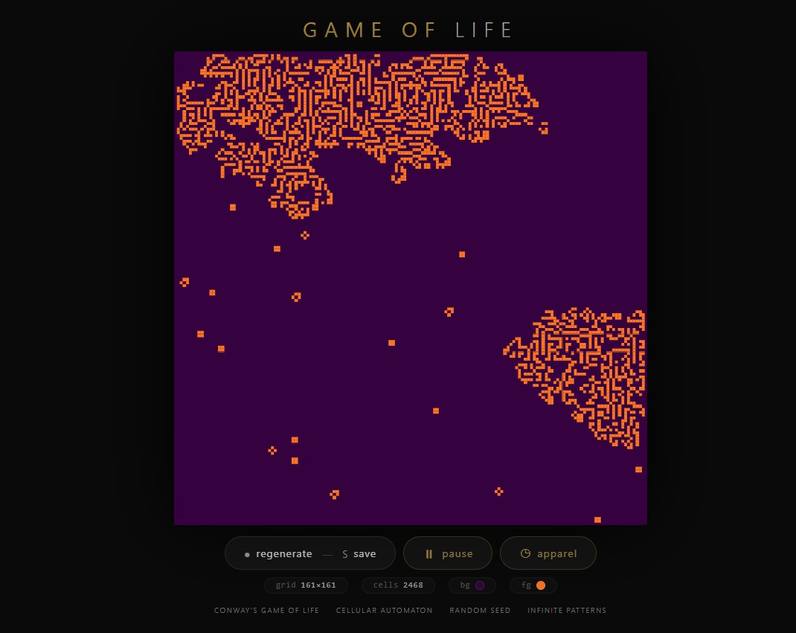
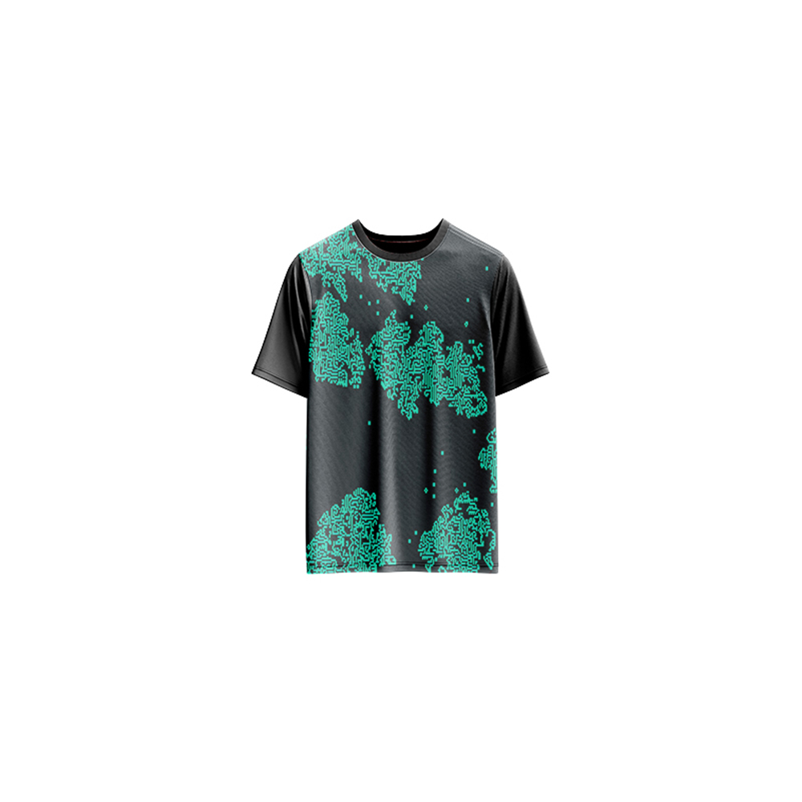

# Game of Life — Generative Art

[](https://reyrove.github.io/Game-of-Life-Generative-Art)
[](https://opensource.org/licenses/MIT)

> **Generative cellular automaton art.** Each refresh creates a unique Conway's Game of Life simulation with random colors, grid sizes, and infinite evolving patterns.

## 🎨 Live Demo

<div align="center">
  <a href="https://reyrove.github.io/Game-of-Life-Generative-Art" target="_blank">
    
  </a>
  <br><br>
  <a href="https://reyrove.github.io/Game-of-Life-Generative-Art" target="_blank">
    
  </a>
  <br>
  <em>Click the image or button to experience the generative art</em>
</div>

## 👕 Apparel Preview

<div align="center">
  
  <br>
  <em>Game of Life artwork printed on a T-shirt</em>
</div>

## ✨ Features

- **Conway's Game of Life** — Classic cellular automaton simulation
- **Random Color Palettes** — 28 background and 28 foreground colors
- **Variable Grid Sizes** — 100×100 to 300×300 cells
- **Pause/Resume** — Control the simulation flow
- **Save as GIF** — Capture the evolution as an animated GIF
- **Apparel Mode** — Preview artwork on a T-shirt mockup
- **Responsive** — Works on desktop, tablet, and mobile
- **Pure p5.js** — Built with the creative coding library
- **Keyboard Shortcuts**:
  - `Space` or `P` — Pause/Resume
  - `R` — Regenerate
  - `S` — Save as GIF
  - `T` — Toggle apparel view

## 🎨 Artwork Details

| Parameter | Range | Description |
|-----------|-------|-------------|
| **Grid Size** | 100–300 | Cells per row/column |
| **Background Colors** | 28 options | Dark cosmic palette |
| **Foreground Colors** | 28 options | Vibrant cell colors |
| **Initial Density** | 6% | Random live cells |
| **Simulation Speed** | 10 FPS | Frames per second |

## 🧬 The Game of Life Rules

Conway's Game of Life follows four simple rules:

1. **Underpopulation** — Any live cell with fewer than 2 live neighbors dies
2. **Survival** — Any live cell with 2 or 3 live neighbors lives on
3. **Overpopulation** — Any live cell with more than 3 live neighbors dies
4. **Reproduction** — Any dead cell with exactly 3 live neighbors becomes alive

Despite these simple rules, complex and beautiful patterns emerge.

## 🚀 Quick Start

### Local Development

```bash
# Clone the repository
git clone https://github.com/reyrove/Game-of-Life-Generative-Art.git

# Navigate to the directory
cd Game-of-Life-Generative-Art

# Open in browser
open index.html
# or use a live server
```

### Deploy to GitHub Pages

1. Push to GitHub
2. Go to Settings → Pages
3. Select branch `main` and root folder
4. Your site will be live at `https://reyrove.github.io/Game-of-Life-Generative-Art`

## 🧠 How It Works

The artwork is generated using a random seed and the classic Game of Life algorithm:

1. **Setup**:
   - Random background and foreground colors
   - Random grid size (100-300 cells)
   - 6% random cell initialization

2. **Simulation**:
   - Each generation updates all cells simultaneously
   - Rules applied to determine next state
   - Live cells drawn in foreground color
   - Dead cells remain as background

3. **Interaction**:
   - Pause/Resume the simulation
   - Regenerate with new random parameters
   - Save the current evolution as GIF

## 📁 File Structure

```
Game-of-Life-Generative-Art/
├── index.html          # Main application (all-in-one)
├── Game-of-Life.jpg    # T-shirt mockup image
├── fav.svg             # Favicon
├── demo-screenshot.jpg # Website demo screenshot
├── README.md           # This file
└── LICENSE             # MIT License
```

## 🛠️ Tech Stack

- **p5.js** — Creative coding library
- **Canvas API** — 2D rendering
- **CSS Flexbox/Grid** — Responsive layout
- **GitHub Pages** — Hosting

## 🎯 Interactive Controls

| Action | Keyboard | Button |
|--------|----------|--------|
| Pause/Resume | `Space` or `P` | Click "pause" |
| Regenerate | `R` | Click "regenerate" |
| Save as GIF | `S` | Click "regenerate" |
| Toggle Apparel | `T` | Click "apparel" |

## 🎨 The Creative Process

### Emergent Patterns
The Game of Life is famous for its emergent complexity. From simple rules, patterns like gliders, oscillators, and spaceships can emerge, creating endlessly fascinating visual art.

### Color Palettes
28 carefully curated dark background colors and 28 vibrant foreground colors create striking contrasts that make the cellular patterns pop.

### Living Art
The simulation is alive—cells are born, live, and die in an endless dance of creation and destruction, making each moment unique.

## 📱 Responsive Design

The application automatically adapts to:
- Desktop screens
- Tablets
- Mobile phones
- Landscape orientation
- Various aspect ratios

## 🤝 Contributing

Contributions are welcome! Feel free to:
- Fork the repository
- Create a feature branch
- Submit a pull request

### Ideas for Contributions:
- New color palettes
- Pattern presets (gliders, oscillators)
- Speed controls
- Click to add/remove cells
- Performance optimizations

## 📄 License

MIT License — see [LICENSE](LICENSE) file for details.

## 🙏 Acknowledgments

- Created with p5.js
- Inspired by Conway's Game of Life
- Special thanks to the creative coding community

---

**Built with ❤️ and living cells**